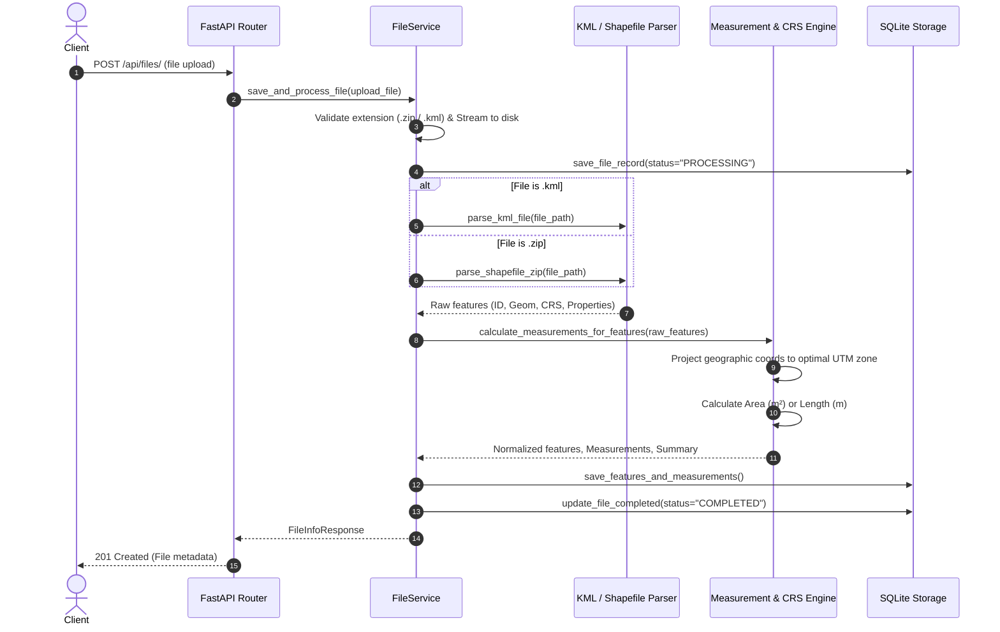
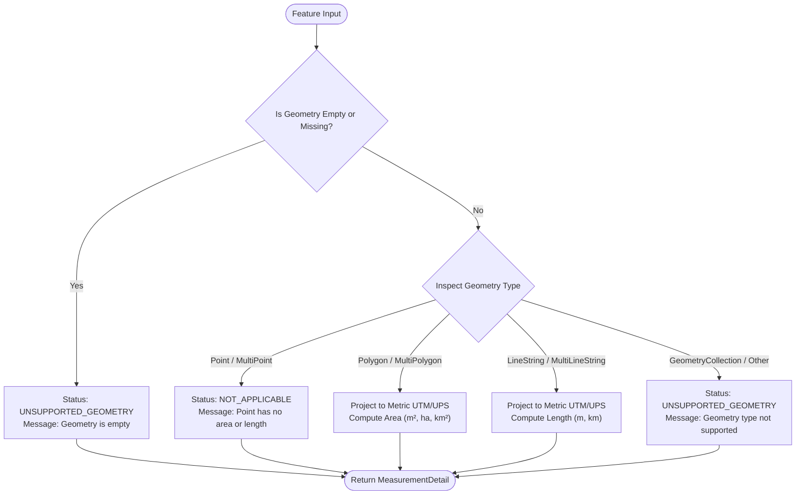

# Geospatial File Measurement API

A production-ready, high-performance RESTful API built with **FastAPI**, **Shapely**, **PyProj**, and **Fiona** that accepts geospatial vector files (**ESRI Shapefile `.zip`** and Keyhole Markup Language **`.kml`**), parses geometric features, correctly projects geographic coordinates to appropriate metric coordinate reference systems, and calculates precise geometric measurements (Area for Polygons, Length for LineStrings).

---

## Table of Contents
1. [Overview & Key Features](#overview--key-features)
2. [Local Setup & Installation](#local-setup--installation)
   - [Option A: Local Python Virtual Environment](#option-a-local-python-virtual-environment)
   - [Option B: Docker & Docker Compose](#option-b-docker--docker-compose)
3. [API Documentation](#api-documentation)
   - [Interactive Swagger / OpenAPI Docs](#interactive-swagger--openapi-docs)
   - [1. Upload & Process File (`POST /api/files/`)](#1-upload--process-file-post-apifiles)
   - [2. Get File Information (`GET /api/files/{id}/`)](#2-get-file-information-get-apifilesid)
   - [3. Get Feature Measurements (`GET /api/files/{id}/measurements/`)](#3-get-feature-measurements-get-apifilesidmeasurements)
   - [4. Get Extracted Features (`GET /api/files/{id}/features/`)](#4-get-extracted-features-get-apifilesidfeatures)
   - [5. List Files (`GET /api/files/`)](#5-list-files-get-apifiles)
   - [6. Delete File (`DELETE /api/files/{id}/`)](#6-delete-file-delete-apifilesid)
   - [7. Health Check (`GET /api/health`)](#7-health-check-get-apihealth)
4. [Architecture](#architecture)
   - [Application Directory Structure](#application-directory-structure)
   - [File Processing Flow](#file-processing-flow)
   - [Measurement Calculation Flow](#measurement-calculation-flow)
   - [CRS Handling & Geodesy Strategy](#crs-handling--geodesy-strategy)
5. [Design Decisions & Alternatives Considered](#design-decisions--alternatives-considered)
6. [Security Considerations](#security-considerations)
7. [Running Tests](#running-tests)
8. [Learnings & Future Scope](#learnings--future-scope)

---

## Overview & Key Features

- **Multi-Format Support**: Ingests zipped ESRI Shapefiles (`.zip` containing `.shp`, `.shx`, `.dbf`, `.prj`) and Keyhole Markup Language files (`.kml`).
- **Mathematically Accurate Geodesy**: Prevents naive Euclidean calculations on angular coordinates (degrees). Automatically determines the optimal **Universal Transverse Mercator (UTM)** or **Universal Polar Stereographic (UPS)** metric projection based on feature centroids to calculate area ($m^2$, hectares, $km^2$) and length ($m$, $km$).
- **Graceful Fault Tolerance**: Safely handles non-measurable geometries (`Point`, `MultiPoint`, empty geometries, `GeometryCollection`) without crashing, returning explicit descriptive status flags (`CALCULATED`, `NOT_APPLICABLE`, `UNSUPPORTED_GEOMETRY`).
- **Security Hardened**: Built-in protection against **Zip Slip** directory traversal attacks on uploaded archives and **XXE / Billion Laughs** XML vulnerabilities via `defusedxml`.
- **Persistent Storage**: Lightweight, zero-dependency SQLite repository persisting uploaded file metadata, features, and measurements across service restarts.
- **High Test Coverage**: 31 unit and integration tests with >88% statement coverage.

---

## Local Setup & Installation

### Option A: Local Python Virtual Environment

#### Prerequisites
- Python 3.10 or higher
- `pip` package manager

#### 1. Clone the Repository
```bash
git clone https://github.com/your-username/geospatial-measurement-api.git
cd geospatial-measurement-api
```

#### 2. Create and Activate Virtual Environment
On Linux / macOS:
```bash
python3 -m venv .venv
source .venv/bin/activate
```

On Windows (PowerShell):
```powershell
python -m venv .venv
.venv\Scripts\Activate.ps1
```

#### 3. Install Dependencies
```bash
pip install --upgrade pip
pip install -r requirements.txt
```

#### 4. (Optional) Generate Sample Geospatial Datasets
Run the provided generator script to produce ready-to-test `.kml` and Shapefile `.zip` files:
```bash
python scripts/generate_sample_data.py
```
This will populate `sample_data/` with:
- `sample_polygons.kml` (Urban Parcels)
- `sample_linestrings.kml` (Transit routes)
- `sample_points.kml` (Stations)
- `sample_mixed.kml` (Parcels, canals, and pumping stations)
- `sample_parcels_shp.zip` (Shapefile polygons)
- `sample_roads_shp.zip` (Shapefile linestrings)

#### 5. Start the API Server
```bash
uvicorn app.main:app --host 0.0.0.0 --port 8000 --reload
```
The application will start at: `http://localhost:8000`

---

### Option B: Docker & Docker Compose

Docker packages GDAL, GEOS, and PROJ C-libraries in an isolated Ubuntu container.

#### 1. Build and Run with Docker Compose
```bash
docker compose up --build -d
```

#### 2. Verify Container Health
```bash
docker compose ps
curl http://localhost:8000/api/health
```

#### 3. Stop Container
```bash
docker compose down
```

---

## API Documentation

### Interactive Swagger / OpenAPI Docs
Once the server is running, explore and execute requests directly from your browser:
- **Swagger UI**: [http://localhost:8000/docs](http://localhost:8000/docs)
- **ReDoc**: [http://localhost:8000/redoc](http://localhost:8000/redoc)

---

### 1. Upload & Process File (`POST /api/files/`)
Uploads a geospatial vector file, extracts its features, computes projected measurements, and stores results.

- **URL**: `POST /api/files/`
- **Content-Type**: `multipart/form-data`
- **Payload**: Form field `file` (`.zip` Shapefile or `.kml`)

#### Example Request (cURL):
```bash
curl -X POST "http://localhost:8000/api/files/" \
     -H "Accept: application/json" \
     -F "file=@sample_data/sample_polygons.kml"
```

#### Example Response (`201 Created`):
```json
{
  "id": "89bbd83db5de",
  "filename": "sample_polygons.kml",
  "feature_count": 2,
  "crs": "EPSG:4326",
  "status": "COMPLETED",
  "file_size_bytes": 1420,
  "geometry_breakdown": {
    "Polygon": 2
  },
  "created_at": "2026-10-07T19:28:39.088123+00:00",
  "error_message": null
}
```

---

### 2. Get File Information (`GET /api/files/{id}/`)
Retrieves processing status and metadata for an uploaded file.

- **URL**: `GET /api/files/{id}/`
- **Response Model**: `FileInfoResponse`

#### Example Request (cURL):
```bash
curl -X GET "http://localhost:8000/api/files/89bbd83db5de/"
```

#### Example Response (`200 OK`):
```json
{
  "id": "89bbd83db5de",
  "filename": "sample_polygons.kml",
  "feature_count": 2,
  "crs": "EPSG:4326",
  "status": "COMPLETED",
  "file_size_bytes": 1420,
  "geometry_breakdown": {
    "Polygon": 2
  },
  "created_at": "2026-10-07T19:28:39.088123+00:00",
  "error_message": null
}
```

---

### 3. Get Feature Measurements (`GET /api/files/{id}/measurements/`)
Returns calculated measurements for all features in the file.
- **Polygons**: Area in square meters ($m^2$), hectares ($ha$), and square kilometers ($km^2$).
- **LineStrings**: Length in meters ($m$) and kilometers ($km$).
- **Points**: Handled gracefully (`NOT_APPLICABLE`).
- **Summary**: Aggregated totals for the whole dataset.

#### Example Request (cURL):
```bash
curl -X GET "http://localhost:8000/api/files/89bbd83db5de/measurements/"
```

#### Example Response (`200 OK`):
```json
{
  "file_id": "89bbd83db5de",
  "filename": "sample_polygons.kml",
  "crs": "EPSG:4326",
  "summary": {
    "total_features": 2,
    "polygon_count": 2,
    "linestring_count": 0,
    "point_count": 0,
    "unsupported_count": 0,
    "total_area_sq_m": 58376.1245,
    "total_area_hectares": 5.837612,
    "total_area_sq_km": 0.058376,
    "total_length_m": 0.0,
    "total_length_km": 0.0
  },
  "features": [
    {
      "feature_id": "parcel_01",
      "geometry_type": "Polygon",
      "properties": {
        "name": "North Quad",
        "description": "Green lawn and park area",
        "zone": "Commercial-A",
        "tax_id": "9042"
      },
      "is_supported": true,
      "measurement_status": "CALCULATED",
      "area_sq_m": 9734.2541,
      "area_hectares": 0.973425,
      "area_sq_km": 0.009734,
      "length_m": null,
      "length_km": null,
      "projected_crs": "EPSG:32610",
      "message": "Area successfully calculated in metric projected CRS."
    },
    {
      "feature_id": "parcel_02",
      "geometry_type": "Polygon",
      "properties": {
        "name": "South Plaza",
        "description": "Paved square area",
        "zone": "Public-B",
        "tax_id": "9043"
      },
      "is_supported": true,
      "measurement_status": "CALCULATED",
      "area_sq_m": 48641.8704,
      "area_hectares": 4.864187,
      "area_sq_km": 0.048642,
      "length_m": null,
      "length_km": null,
      "projected_crs": "EPSG:32610",
      "message": "Area successfully calculated in metric projected CRS."
    }
  ]
}
```

---

### 4. Get Extracted Features (`GET /api/files/{id}/features/`)
Returns extracted raw features with their GeoJSON geometry representations, source CRS, and attribute properties.

#### Example Request (cURL):
```bash
curl -X GET "http://localhost:8000/api/files/89bbd83db5de/features/"
```

#### Example Response (`200 OK`):
```json
{
  "file_id": "89bbd83db5de",
  "total_features": 2,
  "features": [
    {
      "feature_id": "parcel_01",
      "geometry_type": "Polygon",
      "geometry": {
        "type": "Polygon",
        "coordinates": [
          [
            [-122.4194, 37.7749],
            [-122.4184, 37.7749],
            [-122.4184, 37.7759],
            [-122.4194, 37.7759],
            [-122.4194, 37.7749]
          ]
        ]
      },
      "crs": "EPSG:4326",
      "properties": {
        "name": "North Quad",
        "zone": "Commercial-A",
        "tax_id": "9042"
      }
    }
  ]
}
```

---

### 5. List Files (`GET /api/files/`)
Paginated retrieval of all uploaded files.

```bash
curl -X GET "http://localhost:8000/api/files/?limit=20&offset=0"
```

---

### 6. Delete File (`DELETE /api/files/{id}/`)
Removes the uploaded file from the storage directory and deletes all associated records from SQLite.

```bash
curl -X DELETE "http://localhost:8000/api/files/89bbd83db5de/"
```
Response: `204 No Content`

---

### 7. Health Check (`GET /api/health`)
Provides service status, installed Python version, and loaded geospatial engine versions.

```bash
curl -X GET "http://localhost:8000/api/health"
```

---

## Architecture

### Application Directory Structure
```
geospatial-measurement-api/
├── app/
│   ├── __init__.py
│   ├── main.py                     # FastAPI application, exception handlers, middleware
│   ├── config.py                   # Environment settings & directory initialization
│   ├── api/
│   │   ├── __init__.py
│   │   └── v1/
│   │       ├── __init__.py
│   │       ├── router.py           # Combined API v1 router
│   │       └── endpoints/
│   │           ├── __init__.py
│   │           ├── files.py        # POST /api/files/, GET /api/files/{id}/, DELETE
│   │           ├── measurements.py # GET /api/files/{id}/measurements/
│   │           └── health.py       # GET /api/health
│   ├── core/
│   │   ├── __init__.py
│   │   ├── exceptions.py           # Domain exceptions (GeospatialError hierarchy)
│   │   └── crs.py                  # Dynamic UTM/UPS projection engine & PyProj caching
│   ├── db/
│   │   ├── __init__.py
│   │   └── storage.py              # SQLite storage repository (Files, Features, Measurements)
│   ├── schemas/
│   │   ├── __init__.py
│   │   ├── file.py                 # File info and upload Pydantic models
│   │   ├── feature.py              # Normalized GeoJSON feature Pydantic models
│   │   └── measurement.py          # Measurement detail & summary Pydantic models
│   └── services/
│       ├── __init__.py
│       ├── file_service.py         # File ingestion coordinator
│       ├── kml_parser.py           # Safe KML XML parser (defusedxml + Shapely)
│       ├── shapefile_parser.py     # Safe .zip Shapefile parser (Fiona + Shapely)
│       └── measurement_service.py  # Feature calculation orchestrator
├── tests/
│   ├── __init__.py
│   ├── conftest.py                 # TestClient fixture and test paths
│   ├── test_api.py                 # API integration tests
│   ├── test_crs.py                 # CRS determination & reprojection accuracy tests
│   ├── test_edge_cases.py          # Multi-polygons, collections, hemisphere tests
│   ├── test_kml_parser.py          # KML parser tests
│   └── test_shapefile_parser.py    # Shapefile zip parser tests
├── sample_data/                    # Sample geospatial files (.kml, .zip)
├── scripts/
│   └── generate_sample_data.py     # Deterministic sample dataset generator
├── Dockerfile                      # Production container image definition
├── docker-compose.yml              # Local orchestration
├── requirements.txt                # Pinned production requirements
└── README.md                       # Comprehensive documentation
```

---

### File Processing Flow



---

### Measurement Calculation Flow



---

### CRS Handling & Geodesy Strategy

#### The Problem with Geographic Coordinates (`EPSG:4326`)
A standard GPS or KML file represents coordinates as angular quantities:
$$\text{Latitude } (\phi) \text{ and Longitude } (\lambda) \text{ in decimal degrees.}$$

Calculating Euclidean distance or area directly using standard planar formulas on latitude/longitude degrees results in massive geometric distortion:
1. **Latitude**: $1^\circ$ of latitude is approximately $111\text{ km}$ everywhere on Earth.
2. **Longitude**: $1^\circ$ of longitude is approximately $111 \times \cos(\phi)\text{ km}$.
   - At the Equator ($\phi = 0^\circ$): $1^\circ \approx 111\text{ km}$.
   - At London / Paris ($\phi \approx 50^\circ$): $1^\circ \approx 71\text{ km}$.
   - Near the Poles ($\phi \to 90^\circ$): $1^\circ \to 0\text{ km}$.

Treating degrees as Cartesian meters yields meaningless units (square degrees) that misrepresent actual physical areas by thousands of percentage points.

#### The Metric Reprojection Solution
This API implements an automated **Centroid-Based UTM/UPS Projection Engine**:

1. **Centroid Inspection**: If the geometry is in a geographic coordinate system (`EPSG:4326` or without linear metric units), its geometric centroid $(\bar{\lambda}, \bar{\phi})$ is extracted.
2. **Zone Determination**:
   - For polar regions ($|\bar{\phi}| > 84^\circ$), Universal Polar Stereographic is selected (`EPSG:32661` for North, `EPSG:32761` for South).
   - For all other locations, the Universal Transverse Mercator (UTM) zone is computed:
     $$\text{Zone} = \left\lfloor \frac{\bar{\lambda} + 180}{6} \right\rfloor + 1$$
   - Northern Hemisphere ($\bar{\phi} \ge 0^\circ$): $\text{EPSG:32600} + \text{Zone}$
   - Southern Hemisphere ($\bar{\phi} < 0^\circ$): $\text{EPSG:32700} + \text{Zone}$
3. **Reprojection via PyProj**: Geometry coordinates are transformed to the target projected CRS using cached, thread-safe `pyproj.Transformer` instances (`always_xy=True`).
4. **Metric Measurement**: Measurements are executed on the projected geometry:
   - **Area**: Planar integration in square meters ($m^2$), with conformal scale distortion typically under $0.04\%$ inside the UTM zone.
   - **Length**: Planar integration in meters ($m$).

---

## Design Decisions & Alternatives Considered

| Decision Area | Chosen Approach | Alternative Considered | Rationale |
| :--- | :--- | :--- | :--- |
| **Backend Framework** | **FastAPI** | Django + DRF | FastAPI offers exceptional performance (Starlette async engine), native OpenAPI/Swagger auto-documentation, automatic request validation with Pydantic v2, and lightweight footprint without the overhead of Django's monolithic ORM/admin. |
| **KML Parsing** | **Custom Parser via `defusedxml` + Shapely** | Fiona KML driver / `fastkml` | Standard Fiona / GDAL binary wheels on Windows often omit the `LIBKML` or `EXPAT` driver. Writing a dedicated, namespace-agnostic parser using `defusedxml` ensures 100% platform portability across all OS environments and completely eliminates XML entity expansion vulnerabilities. |
| **Shapefile Processing** | **Fiona + Safe Zip Extractor** | `pyshp` (shapefile library) | Fiona is the industry standard Python binding for OGR vector data. It handles companion `.prj`, `.shx`, `.dbf`, and `.cpg` files natively and reads projection definitions directly into `pyproj.CRS`. |
| **Database & Metadata** | **SQLite with Foreign Keys** | PostgreSQL + PostGIS | SQLite is embedded, requires zero background daemon configuration, is immediately usable in containerized and local developer environments, and delivers millisecond query response times. The architecture encapsulates all queries in `StorageManager`, making future migration to PostgreSQL trivial. |
| **Measurement Projection** | **Centroid-based UTM / UPS** | Great-circle (Haversine) / Geodetic Karney algorithm | While ellipsoidal geodesic distance (e.g. `Geod.inv`) works for single line segments, standard GIS workflows and polygon area calculation with complex holes, multi-polygons, and planar overlays are far more reliably calculated and standardized via UTM/projected planar geometries. |

---

## Security Considerations

1. **Zip Slip Prevention**: Unpacking user-uploaded zip archives exposes systems to directory traversal attacks where malicious archive member paths (e.g., `../../etc/passwd`) escape the destination directory. `shapefile_parser.py` explicitly validates that all resolved archive member paths remain strictly inside the temporary extraction sandbox.
2. **XML Vulnerabilities (XXE / Billion Laughs)**: Ingesting untrusted KML (XML) files can expose the host to XML External Entity (XXE) attacks, SSRF, or exponential memory consumption. We strictly use `defusedxml.ElementTree` to parse KML documents safely.
3. **Upload Size Bounds**: Uploads stream in 64 KB chunks, rejecting files larger than `MAX_FILE_SIZE_MB` (50 MB by default) before exhaustively consuming system memory.
4. **Temporary Directory Cleanup**: Shapefile extraction directories are allocated via `tempfile.mkdtemp` and unconditionally unlinked in a `finally` block.

---

## Running Tests

The test suite contains **31 comprehensive unit and integration tests** testing CRS accuracy, KML parsing edge cases, shapefile unpacking, API endpoints, and error handling.

To run tests with pytest and coverage reporting:
```bash
pytest --cov=app --cov-report=term-missing
```

Sample output:
```
tests\test_api.py ............                                           [ 38%]
tests\test_crs.py ....                                                   [ 51%]
tests\test_edge_cases.py .....                                           [ 67%]
tests\test_kml_parser.py ......                                          [ 87%]
tests\test_shapefile_parser.py ....                                      [100%]

=============================== tests coverage ================================
Name                                   Stmts   Miss  Cover
----------------------------------------------------------
app\api\v1\endpoints\files.py             43      2    95%
app\api\v1\endpoints\health.py            10      0   100%
app\api\v1\endpoints\measurements.py      15      2    87%
app\db\storage.py                         75      0   100%
app\schemas\feature.py                    16      0   100%
app\schemas\file.py                       29      0   100%
app\schemas\measurement.py                39      0   100%
app\services\file_service.py             112      7    94%
app\services\measurement_service.py       68      7    90%
app\services\shapefile_parser.py          79     11    86%
----------------------------------------------------------
TOTAL                                    765     87    89%
======================= 31 passed in 0.88s ========================
```

---

## Learnings & Future Scope

### Key Learnings
1. **Coordinate Systems & Distortions**: Geographic coordinates ($(\text{lon}, \text{lat})$ in degrees) are non-metric angular measurements. Performing standard Euclidean math on degrees causes distortions of several orders of magnitude. Selecting a local projected coordinate system (such as UTM) is mandatory for reliable physical measurement calculation.
2. **KML Namespace Variations**: Real-world KML files from Google Earth, ArcGIS, and QGIS frequently use disparate XML namespaces (`http://www.opengis.net/kml/2.2`, `http://earth.google.com/kml/2.0`, or un-namespaced tags). Building a namespace-agnostic tag resolution layer prevents fragile parsing bugs.
3. **Security in Geospatial Ingestion**: Processing archive formats and XML requires defensive coding patterns: explicitly checking extracted paths against destination root bounds to stop Zip Slip attacks, and using `defusedxml` to safeguard against entity expansion vulnerabilities.

### Future Scope
1. **Asynchronous Background Processing (Celery / Redis / ARQ)**: For massive datasets (e.g. multi-gigabyte shapefiles with millions of features), decouple ingestion from processing by offloading calculation to asynchronous worker queues with WebSocket progress notifications.
2. **Support for Additional Geospatial Formats**:
   - GeoJSON (`.geojson` / `.json`)
   - GeoPackage (`.gpkg`)
   - FlatGeobuf (`.fgb`)
   - GeoTIFF / Raster raster surface area calculations
3. **Advanced Geodetic Calculations (Equal-Area / Equal-Distance Projections)**:
   - Local Lambert Azimuthal Equal Area (LAEA) centered on feature centroids for global cross-zone polygons.
   - Local Azimuthal Equidistant (AEQD) projections for long intercontinental transect linestrings.
4. **Spatial Indexing & Cloud-Native Storage**:
   - PostgreSQL + PostGIS backend with GiST / R-Tree spatial indexing for bounding box queries.
   - S3 / GCS cloud object storage integration for uploaded file archives.
